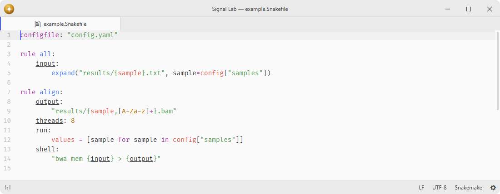

# language-snakemake

Snakemake language support.

## Features

- **Grammars**: provides Tree-sitter grammars, built from [tree-sitter-snakemake](https://github.com/osthomas/tree-sitter-snakemake).
- **Syntax highlighting**: combines Python highlighting with rules, directives, wildcards, and workflow built-ins.
- **Editing**: provides parse-tree folding and indentation for Python and Snakemake blocks.
- **Navigation**: exposes rule, checkpoint, module, Python, and local definitions from Tree-sitter queries.
- **Embedded regex**: parses wildcard constraints with the shared regex grammar when available.

## Installation

To install `language-snakemake` search for it in the Install pane of the Lumine settings, or run the command `lumine --install lumine-code/language-snakemake`.

## Injections

- Static Tree-sitter injections highlight URLs with `language-hyperlink`.
- Static Tree-sitter injections highlight comment markers with `language-todo`.

## Contributing

Got ideas to make this package better, found a bug, or want to help add new features? Just drop your thoughts on GitHub. Any feedback is welcome!
